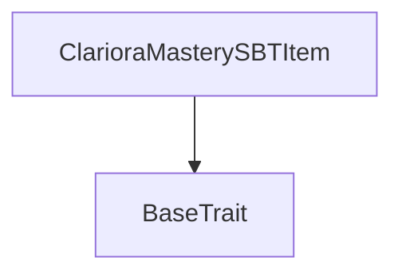
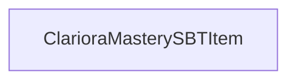

# Tact compilation report
Contract: ClarioraMasterySBTItem
BoC Size: 1067 bytes

## Structures (Structs and Messages)
Total structures: 22

### DataSize
TL-B: `_ cells:int257 bits:int257 refs:int257 = DataSize`
Signature: `DataSize{cells:int257,bits:int257,refs:int257}`

### SignedBundle
TL-B: `_ signature:fixed_bytes64 signedData:remainder<slice> = SignedBundle`
Signature: `SignedBundle{signature:fixed_bytes64,signedData:remainder<slice>}`

### StateInit
TL-B: `_ code:^cell data:^cell = StateInit`
Signature: `StateInit{code:^cell,data:^cell}`

### Context
TL-B: `_ bounceable:bool sender:address value:int257 raw:^slice = Context`
Signature: `Context{bounceable:bool,sender:address,value:int257,raw:^slice}`

### SendParameters
TL-B: `_ mode:int257 body:Maybe ^cell code:Maybe ^cell data:Maybe ^cell value:int257 to:address bounce:bool = SendParameters`
Signature: `SendParameters{mode:int257,body:Maybe ^cell,code:Maybe ^cell,data:Maybe ^cell,value:int257,to:address,bounce:bool}`

### MessageParameters
TL-B: `_ mode:int257 body:Maybe ^cell value:int257 to:address bounce:bool = MessageParameters`
Signature: `MessageParameters{mode:int257,body:Maybe ^cell,value:int257,to:address,bounce:bool}`

### DeployParameters
TL-B: `_ mode:int257 body:Maybe ^cell value:int257 bounce:bool init:StateInit{code:^cell,data:^cell} = DeployParameters`
Signature: `DeployParameters{mode:int257,body:Maybe ^cell,value:int257,bounce:bool,init:StateInit{code:^cell,data:^cell}}`

### StdAddress
TL-B: `_ workchain:int8 address:uint256 = StdAddress`
Signature: `StdAddress{workchain:int8,address:uint256}`

### VarAddress
TL-B: `_ workchain:int32 address:^slice = VarAddress`
Signature: `VarAddress{workchain:int32,address:^slice}`

### BasechainAddress
TL-B: `_ hash:Maybe int257 = BasechainAddress`
Signature: `BasechainAddress{hash:Maybe int257}`

### Deploy
TL-B: `deploy#946a98b6 queryId:uint64 = Deploy`
Signature: `Deploy{queryId:uint64}`

### DeployOk
TL-B: `deploy_ok#aff90f57 queryId:uint64 = DeployOk`
Signature: `DeployOk{queryId:uint64}`

### FactoryDeploy
TL-B: `factory_deploy#6d0ff13b queryId:uint64 cashback:address = FactoryDeploy`
Signature: `FactoryDeploy{queryId:uint64,cashback:address}`

### CollectionData
TL-B: `_ nextItemIndex:uint64 collectionContent:^cell ownerAddress:address = CollectionData`
Signature: `CollectionData{nextItemIndex:uint64,collectionContent:^cell,ownerAddress:address}`

### NftData
TL-B: `_ isActive:bool index:uint64 collectionAddress:address ownerAddress:address individualContent:^cell = NftData`
Signature: `NftData{isActive:bool,index:uint64,collectionAddress:address,ownerAddress:address,individualContent:^cell}`

### MasteryRecord
TL-B: `_ examCode:^string scaledScore:uint16 ledgerHash:uint256 = MasteryRecord`
Signature: `MasteryRecord{examCode:^string,scaledScore:uint16,ledgerHash:uint256}`

### MintMasterySBT
TL-B: `mint_mastery_sbt#87f742fb queryId:uint64 recipient:address examCode:^string scaledScore:uint16 ledgerHash:uint256 metadataUri:^string = MintMasterySBT`
Signature: `MintMasterySBT{queryId:uint64,recipient:address,examCode:^string,scaledScore:uint16,ledgerHash:uint256,metadataUri:^string}`

### ProveOwnership
TL-B: `prove_ownership#01c90965 queryId:uint64 dest:address forwardPayload:^cell withContent:bool = ProveOwnership`
Signature: `ProveOwnership{queryId:uint64,dest:address,forwardPayload:^cell,withContent:bool}`

### OwnershipProof
TL-B: `ownership_proof#45a5a4db queryId:uint64 itemId:uint64 owner:address data:^cell revokedAt:uint64 content:Maybe ^cell = OwnershipProof`
Signature: `OwnershipProof{queryId:uint64,itemId:uint64,owner:address,data:^cell,revokedAt:uint64,content:Maybe ^cell}`

### RevokeSBT
TL-B: `revoke_sbt#d99e1cca queryId:uint64 = RevokeSBT`
Signature: `RevokeSBT{queryId:uint64}`

### ClarioraMasterySBTCollection$Data
TL-B: `_ owner:address oracle:address nextItemIndex:uint64 collectionContent:^cell = ClarioraMasterySBTCollection`
Signature: `ClarioraMasterySBTCollection{owner:address,oracle:address,nextItemIndex:uint64,collectionContent:^cell}`

### ClarioraMasterySBTItem$Data
TL-B: `_ collection:address index:uint64 owner:address authority:address examCode:^string scaledScore:uint16 ledgerHash:uint256 revokedAt:uint64 = ClarioraMasterySBTItem`
Signature: `ClarioraMasterySBTItem{collection:address,index:uint64,owner:address,authority:address,examCode:^string,scaledScore:uint16,ledgerHash:uint256,revokedAt:uint64}`

## Get methods
Total get methods: 4

## get_nft_data
No arguments

## get_authority_address
No arguments

## get_revoked_time
No arguments

## get_mastery_record
No arguments

## Exit codes
* 2: Stack underflow
* 3: Stack overflow
* 4: Integer overflow
* 5: Integer out of expected range
* 6: Invalid opcode
* 7: Type check error
* 8: Cell overflow
* 9: Cell underflow
* 10: Dictionary error
* 11: 'Unknown' error
* 12: Fatal error
* 13: Out of gas error
* 14: Virtualization error
* 32: Action list is invalid
* 33: Action list is too long
* 34: Action is invalid or not supported
* 35: Invalid source address in outbound message
* 36: Invalid destination address in outbound message
* 37: Not enough Toncoin
* 38: Not enough extra currencies
* 39: Outbound message does not fit into a cell after rewriting
* 40: Cannot process a message
* 41: Library reference is null
* 42: Library change action error
* 43: Exceeded maximum number of cells in the library or the maximum depth of the Merkle tree
* 50: Account state size exceeded limits
* 128: Null reference exception
* 129: Invalid serialization prefix
* 130: Invalid incoming message
* 131: Constraints error
* 132: Access denied
* 133: Contract stopped
* 134: Invalid argument
* 135: Code of a contract was not found
* 136: Invalid standard address
* 138: Not a basechain address
* 2167: Only owner can destroy
* 10990: Already revoked
* 35998: Only owner can prove ownership
* 39925: Unauthorized mint
* 59333: Only authority can revoke

## Trait inheritance diagram

## Contract dependency diagram

